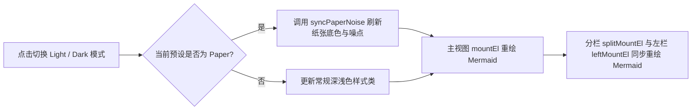

# Beautiful Markdown 三处修复验证文档

本文档用于验证提交 9b81c0c 的三项核心修复：AI 翻译嵌套占位符还原与前置字符保留、双击编辑与划词复制精准定位（含 Frontmatter 跳过与装饰节点过滤）、以及 Paper 预设深浅色背景与分栏 Mermaid 重绘。

---

## 测试点 1：YAML Frontmatter 同名标题与首段的双击定位及划词复制

- **操作步骤**：
  1. 在阅读模式下，直接双击本文档顶部的一级标题「Beautiful Markdown 三处修复验证文档」或第一段正文进入编辑模式（也可以在标题或首段中选中部分文字并按 `Cmd/Ctrl + C` 复制）。
  2. 观察编辑器打开后的光标落点位置（或剪贴板中的文本）。
- **修复前会看到什么**：
  - `offsetForRenderedBlock` 从源码第 0 个字符开始搜索，由于顶部 YAML Frontmatter 的 `title` 与正文一级标题完全相同、`description` 与正文首段完全相同，且标题 DOM 中混入了 `.bsw-heading-anchor` 的 `#` 字符，双击正文一级标题或首段时光标会错误跳进顶部 YAML Frontmatter 区域。
- **修复后应该看到什么**：
  - 定位算法自动跳过开头的 YAML Frontmatter 区域，并过滤掉标题锚点 `#`；双击一级标题或正文首段时，光标精准落在正文对应的 `# Beautiful Markdown 三处修复验证文档` 标题文本或首段文字处。

---

## 测试点 2：AI 翻译嵌套占位符还原与前置字符保留

### 2.1 徽章链接图片（外层链接包裹内层图片）

- **操作步骤**：
  1. 点击页面右上角翻译按钮，对本文档执行全文 AI 翻译（或双语对照翻译）。
  2. 观察下方徽章链接图片在译文中的渲染效果。
- **修复前会看到什么**：
  - `protectMarkdownForTranslation` 先把内层图片 `` 替换为占位符，随后外层链接 `[...](...)` 又将该占位符包裹进新的外层占位符。`restoreProtectedMarkdown` 正向单次遍历还原时，外层占位符展开后露出的内层 `@@BSW_AI_TOKEN_...@@` 无法被继续还原，导致译文中直接暴露 `@@BSW_AI_TOKEN_00000x@@` 字符串，徽章图片破损。
- **修复后应该看到什么**：
  - `restoreProtectedMarkdown` 按逆序（从外层到内层）还原所有占位符，译文中的徽章图片正常显示且点击可正常跳转，不再出现任何 `@@BSW_AI_TOKEN_...@@` 泄漏。

[](https://opensource.org/licenses/MIT) [](https://github.com)

### 2.2 引用块内的 `$$公式$$` 与代码块

- **操作步骤**：
  1. 开启 AI 翻译（在保留引用块或常规翻译模式下），查看下方包含数学公式与代码块的引用块译文。
- **修复前会看到什么**：
  - 引用块内部的 `$$公式$$` 和代码块先生成内层占位符，随后整段引用块生成外层占位符；正向还原时引用块内部会残留未展开的 `@@BSW_AI_TOKEN_...@@`。此外，引用块正则将前置换行符 `\n` 一并吞入占位符，翻译后容易导致引用块与前文粘连在同一行而失去引用样式。
- **修复后应该看到什么**：
  - 引用块的前置换行符保留在占位符外部，逆序还原后引用块结构、`$$公式$$` 以及内部代码块均完整渲染，无占位符残留。

> 引用块嵌套还原验证：下方的欧拉公式、高斯积分以及代码块在翻译后都应当正常渲染，不应泄漏任何占位符。
>
> $$\int_{-\infty}^{\infty} e^{-x^2} \, dx = \sqrt{\pi}, \quad e^{i\pi} + 1 = 0$$
>
> ```javascript
> function verifyQuoteRestore(text) {
>   return !text.includes("@@BSW_AI_TOKEN_");
> }
> ```

### 2.3 括号内的标签 `(#tag)` 与紧邻段落的代码块

- **操作步骤**：
  1. 执行 AI 翻译后，观察下方段落中的括号标签 `(#修复验证)`、`(#release-v1)` 以及段落下方紧邻的代码块。
- **修复前会看到什么**：
  - 标签保护正则 `/(^|[\s([{])#[\p{L}\p{N}_/-]+/gu` 会把前导左括号 `(` 或空格吞进占位符，模型在译文中只看到孤立的右括号 `)`，从而删掉右括号或额外补左括号，导致还原后出现 `(#修复验证` 或 `((#修复验证)`；代码块正则同样吞掉了前置换行符 `\n`，偶发造成代码块与上文粘连。
- **修复后应该看到什么**：
  - 左括号 `(`、空白符和前置换行符 `\n` 均保留在占位符之外，译文中 `(#修复验证)` 与 `(#release-v1)` 的左右括号完整配对，下方代码块保持独立成块。

本段用于测试括号内的标签保护：请确认中文标签 (#修复验证) 与版本标签 (#release-v1) 在翻译后依然带有完整的左右圆括号，且下方代码块换行正常。

---

## 测试点 3：多级标题与带代码块段落的双击定位及拖选复制

### 3.1 标题与代码块的装饰字符过滤（`#` 与 `Copy`）

- **操作步骤**：
  1. 从本小节上方标题「3.1 标题与代码块的装饰字符过滤」开始，按住鼠标左键一路向下拖选，经过下方段落并选中代码块内容，按 `Cmd/Ctrl + C` 复制后粘贴到纯文本编辑器中检查。
  2. 在阅读视图中分别双击上方二级/三级标题，以及双击下方代码块内部的任意一行文字，观察进入编辑模式后的光标位置。
- **修复前会看到什么**：
  - 鼠标拖选复制的结果中，标题末尾会多出 `#`，代码块开头会多出 `Copy` 字样。
  - 双击标题或代码块时，因为 `block.textContent` 与选区文本把 `.bsw-heading-anchor`（`#`）和 `.bsw-code-copy`（`Copy`）统计在内，与 Markdown 源码失配，导致编辑光标定位偏移甚至跳回文档顶部。
- **修复后应该看到什么**：
  - `.bsw-heading-anchor` 与 `.bsw-code-copy` 均带有 `user-select: none`，且 `cleanBlockText` 和选区偏移计算会自动移除这些装饰节点；拖选复制内容干净无 `#` 和 `Copy`，双击标题或代码块时光标精准落在对应源码位置。

这是一段带有代码块的测试段落。你可以先跨段落与下方代码块进行鼠标拖选复制，再双击代码块内部的第 3 行观察光标是否精准落位：

```python
def find_block_offset(markdown: str, snippet: str) -> int:
    """双击此代码块中的任意位置，验证光标是否精准落在该行。"""
    cleaned = snippet.strip()
    return markdown.find(cleaned)
```

---

## 测试点 4：Paper 预设切换深浅色背景更新与分栏 Mermaid 重绘

- **操作步骤**：
  1. 在底部外观面板中将主题预设切换为 **Paper**。
  2. 进入分栏编辑模式（Split View）或开启双语对照双栏视图，使左右两栏同时显示下方的 Mermaid 流程图。
  3. 点击外观面板中的深浅色切换按钮，在 **Light（浅色）** 与 **Dark（深色）** 模式之间切换。
- **修复前会看到什么**：
  - 在 Paper 预设下切换深浅色时，`applyMode` 未触发 `syncPaperNoise`，页面纸张背景色与噪点纹理停留在切换前的状态（例如切到深色后背景依然是浅色纸张底色）。
  - 切换深浅色时只有主阅读栏重绘了 Mermaid 图，分栏预览栏（`splitMountEl`）或双语左栏（`leftMountEl`）中的 Mermaid 图表保持旧主题配色不更新。
- **修复后应该看到什么**：
  - 切换深浅色时，Paper 预设的纸张底色与噪点背景立即同步切换为对应的深色/浅色外观。
  - 主栏与分栏/双语左栏中的 Mermaid 流程图同时重新渲染，节点、线条和文字配色均与当前深浅色模式匹配。


